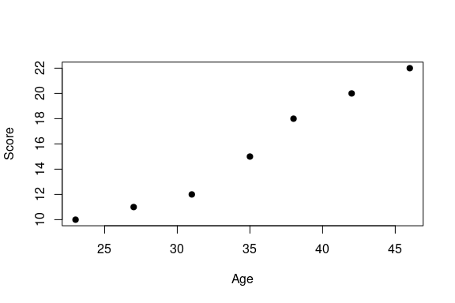
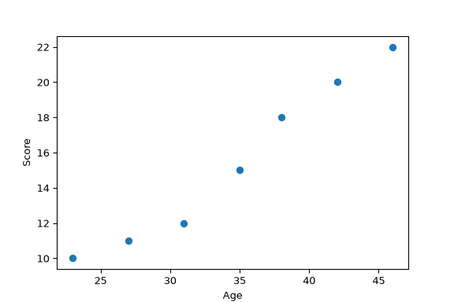

Data Operations: Python vs R
================
Zhenguo Zhang
October 27, 2026

- [Run Python with reticulate](#run-python-with-reticulate)
  - [Passing objects between
    languages](#passing-objects-between-languages)
- [Equivalent packages and a quick
  reference](#equivalent-packages-and-a-quick-reference)
- [Example data and inspection](#example-data-and-inspection)
- [Read and write data](#read-and-write-data)
  - [CSV: an executable round trip](#csv-an-executable-round-trip)
  - [Other formats](#other-formats)
- [Indexing, selection, and
  filtering](#indexing-selection-and-filtering)
  - [Positions versus labels](#positions-versus-labels)
- [Missing values, types, and safe
  assignment](#missing-values-types-and-safe-assignment)
- [Summaries, counts, and
  transformations](#summaries-counts-and-transformations)
  - [Column metrics and grouped
    summaries](#column-metrics-and-grouped-summaries)
  - [Keep one row per observation: group
    transforms](#keep-one-row-per-observation-group-transforms)
- [‘apply’ functions and their
  variants](#apply-functions-and-their-variants)
  - [Summary table](#summary-table)
  - [`apply`: each column or row of a
    matrix](#apply-each-column-or-row-of-a-matrix)
  - [pandas `apply`: columns, rows, or individual
    cells?](#pandas-apply-columns-rows-or-individual-cells)
  - [`lapply`, `sapply`, and `vapply`: iterate over
    collections](#lapply-sapply-and-vapply-iterate-over-collections)
  - [`mapply` and `Map`: multiple inputs and extra
    arguments](#mapply-and-map-multiple-inputs-and-extra-arguments)
  - [`tapply` and `by`: apply within
    groups](#tapply-and-by-apply-within-groups)
  - [`rapply`, elementwise functions, and
    performance](#rapply-elementwise-functions-and-performance)
- [Strings, dates, and categories](#strings-dates-and-categories)
- [Combine and reshape datasets](#combine-and-reshape-datasets)
  - [Bind rows, bind columns, and join
    keys](#bind-rows-bind-columns-and-join-keys)
  - [Index alignment: a major difference from
    R](#index-alignment-a-major-difference-from-r)
  - [Wide and long form](#wide-and-long-form)
- [Probability distributions: R’s d/p/q/r functions in
  Python](#probability-distributions-rs-dpqr-functions-in-python)
  - [Translate the d/p/q/r prefix](#translate-the-dpqr-prefix)
  - [Common distributions and parameter
    translations](#common-distributions-and-parameter-translations)
  - [Normal: density, probability, quantiles, and
    samples](#normal-density-probability-quantiles-and-samples)
  - [Poisson: exact counts and inclusive versus strict
    tails](#poisson-exact-counts-and-inclusive-versus-strict-tails)
- [Basic statistical analyses](#basic-statistical-analyses)
  - [Welch two-sample t-test](#welch-two-sample-t-test)
  - [Spearman rank correlation](#spearman-rank-correlation)
- [Linear and logistic regression](#linear-and-logistic-regression)
  - [A shared modeling dataset](#a-shared-modeling-dataset)
  - [Ordinary least squares](#ordinary-least-squares)
  - [Binary logistic regression](#binary-logistic-regression)
  - [Check that fitted results agree](#check-that-fitted-results-agree)
- [A quick plot in each language](#a-quick-plot-in-each-language)
- [Python habits that matter for R
  users](#python-habits-that-matter-for-r-users)
  - [Functions, containers, and
    iteration](#functions-containers-and-iteration)
  - [Reproducibility and checking
    translations](#reproducibility-and-checking-translations)
- [Troubleshooting and further
  reading](#troubleshooting-and-further-reading)

This guide translates familiar base R, dplyr, and tidyr operations into
Python. Use **pandas** for tables, **NumPy** for arrays, **SciPy** for
probability distributions and statistical tests, and **statsmodels** for
models with coefficients and statistical summaries. The paired examples
operate on the same data so you can compare results.

## Run Python with reticulate

Install the R packages once in the R console:

``` r
install.packages(c("rmarkdown", "reticulate", "dplyr", "tidyr"))
```

The setup below enables Python execution during knitting. With a recent
reticulate, `py_require()` declares dependencies for a managed Python
environment; the first Python import may download Python and packages
and requires internet access. If you already manage Python, set
`RETICULATE_PYTHON` before starting R, or call `use_python()` below
**before Python initializes** and install the listed packages into that
interpreter yourself. Requirements do not automatically install packages
into an explicitly selected existing environment. See [reticulate
environment
setup](https://rstudio.github.io/reticulate/articles/python_packages.html).

``` python
import sys
from pathlib import Path
import tempfile
import numpy as np
import pandas as pd
from scipy import stats
import statsmodels.formula.api as smf
import matplotlib.pyplot as plt

print("Python:", sys.version.split()[0])
```

    ## Python: 3.12.15

``` python
print("pandas:", pd.__version__)
```

    ## pandas: 3.1.0

In RStudio, run the setup first, then run Python chunks with their green
Run buttons or select complete expressions and press Ctrl+Enter
(Cmd+Enter on Mac). All Python chunks share a Python session. Knitting
starts execution in document order; an object left over from interactive
work is not a substitute for a setup chunk. VS Code can render this file
through R, but its usual interactive Python workflow uses `.py` files
with `# %%` cells or Jupyter notebooks.

### Passing objects between languages

R objects are available as `r.object_name` in Python; Python objects are
available as `py$object_name` in R. This avoids exporting a CSV just to
cross the language boundary. Conversion is convenient, but inspect
dtypes, row names, time zones, and categorical levels afterward. See
[reticulate’s Python chunk
guide](https://rstudio.github.io/reticulate/articles/r_markdown.html).

``` r
r_numbers <- c(1, 2, 3, 4)
```

``` python
py_mean = float(np.mean(r.r_numbers))
print(py_mean)
```

    ## 2.5

``` r
stopifnot(isTRUE(all.equal(py$py_mean, mean(r_numbers))))
py$py_mean
```

    ## [1] 2.5

## Equivalent packages and a quick reference

| R | Python | Purpose / difference |
|----|----|----|
| `data.frame`, tibble | `pd.DataFrame` | Tabular data; pandas has explicit row index labels. |
| dplyr | pandas | Select, filter, mutate, summarize, and join. |
| tidyr | pandas `melt`, `pivot`, `pivot_table` | Reshape wide/long data; aggregation must be explicit. |
| readr, base `read.csv` | `pd.read_csv`, `DataFrame.to_csv` | Specify missing-value rules and types where needed. |
| readxl, writexl | `pd.read_excel`, `DataFrame.to_excel` | Excel typically needs the optional `openpyxl` dependency. |
| stringr | pandas `.str` methods, Python `re` | Vectorized text operations versus scalar string methods. |
| lubridate | `pd.to_datetime`, `.dt` methods | Parse dates, extract components, and handle time zones. |
| R vectors, matrices | NumPy `ndarray` | Zero-based indexing; broadcasting differs from R recycling. |
| `t.test`, `cor.test` | `scipy.stats` | Check defaults, missing data, and test method. |
| `dnorm`, `pnorm`, `qnorm`, `rnorm`, etc. | `scipy.stats` distribution methods | Density/mass, cumulative probability, quantiles, and random samples. |
| `lm`, `glm` | statsmodels formula API | R-like formula strings, followed by `.fit()`. |
| ggplot2 | plotnine; Matplotlib | See the companion `plotnine.Rmd` for plot translations. |
| `saveRDS`, `readRDS` | No universal direct equivalent | Prefer interoperable CSV/Parquet for tables; pickle is Python-specific. |

## Example data and inspection

This dataset deliberately contains a missing score, repeated groups, and
dates. IDs are ordinary columns, so joins do not depend on R row names
or pandas indexes.

``` r
df_r <- data.frame(
  id=1:8,
  group=c("control", "treated", "control", "treated",
          "control", "treated", "control", "treated"),
  age=c(23, 35, 29, 42, 31, 38, 27, 46),
  score=c(10, 15, NA, 20, 12, 18, 11, 22),
  visit=c("2026-01-01", "2026-01-02", "2026-01-03", "2026-01-04",
          "2026-01-05", "2026-01-06", "2026-01-07", "2026-01-08")
)
head(df_r)
```

    ##   id   group age score      visit
    ## 1  1 control  23    10 2026-01-01
    ## 2  2 treated  35    15 2026-01-02
    ## 3  3 control  29    NA 2026-01-03
    ## 4  4 treated  42    20 2026-01-04
    ## 5  5 control  31    12 2026-01-05
    ## 6  6 treated  38    18 2026-01-06

``` r
str(df_r)
```

    ## 'data.frame':    8 obs. of  5 variables:
    ##  $ id   : int  1 2 3 4 5 6 7 8
    ##  $ group: chr  "control" "treated" "control" "treated" ...
    ##  $ age  : num  23 35 29 42 31 38 27 46
    ##  $ score: num  10 15 NA 20 12 18 11 22
    ##  $ visit: chr  "2026-01-01" "2026-01-02" "2026-01-03" "2026-01-04" ...

``` python
df = pd.DataFrame({
    "id": range(1, 9),
    "group": ["control", "treated"] * 4,
    "age": [23, 35, 29, 42, 31, 38, 27, 46],
    "score": [10, 15, np.nan, 20, 12, 18, 11, 22],
    "visit": [f"2026-01-{day:02d}" for day in range(1, 9)],
})
print(df.head())
```

    ##    id    group  age  score       visit
    ## 0   1  control   23   10.0  2026-01-01
    ## 1   2  treated   35   15.0  2026-01-02
    ## 2   3  control   29    NaN  2026-01-03
    ## 3   4  treated   42   20.0  2026-01-04
    ## 4   5  control   31   12.0  2026-01-05

``` python
print(df.dtypes)
```

    ## id         int64
    ## group        str
    ## age        int64
    ## score    float64
    ## visit        str
    ## dtype: object

``` python
print(df.shape)
```

    ## (8, 5)

| R operation | pandas equivalent |
|----|----|
| `head(df_r)` / `tail(df_r)` | `df.head()` / `df.tail()` |
| `dim(df_r)` | `df.shape` (a tuple, not a function) |
| `nrow(df_r)` / `ncol(df_r)` | `len(df)` / `df.shape[1]` |
| `names(df_r)` | `df.columns` |
| `str(df_r)` | `df.info()` and `df.dtypes` |
| `summary(df_r)` | `df.describe(include="all")` (different summary layout) |
| `unique(df_r$group)` | `df["group"].unique()` |
| `table(df_r$group, useNA="ifany")` | `df["group"].value_counts(dropna=False)` |

## Read and write data

### CSV: an executable round trip

These examples write only into temporary directories. Substitute your
own paths when working with real files. `Path` joins paths without
manually choosing slash characters. CSV does not preserve every original
data type, factor level, or index automatically.

``` r
r_csv <- file.path(tempdir(), "data-operations-r.csv")
write.csv(df_r, r_csv, row.names=FALSE, na="")
read_r <- read.csv(r_csv, na.strings="", stringsAsFactors=FALSE)
head(read_r)
```

    ##   id   group age score      visit
    ## 1  1 control  23    10 2026-01-01
    ## 2  2 treated  35    15 2026-01-02
    ## 3  3 control  29    NA 2026-01-03
    ## 4  4 treated  42    20 2026-01-04
    ## 5  5 control  31    12 2026-01-05
    ## 6  6 treated  38    18 2026-01-06

``` python
python_dir = Path(tempfile.mkdtemp(prefix="data-operations-"))
python_csv = python_dir / "data.csv"
df.to_csv(python_csv, index=False, na_rep="")
read_py = pd.read_csv(python_csv, dtype={"id": "int64"}, na_values=[""])
print(read_py.head())
```

    ##    id    group  age  score       visit
    ## 0   1  control   23   10.0  2026-01-01
    ## 1   2  treated   35   15.0  2026-01-02
    ## 2   3  control   29    NaN  2026-01-03
    ## 3   4  treated   42   20.0  2026-01-04
    ## 4   5  control   31   12.0  2026-01-05

`index=False` prevents an extra unnamed index column, much like R’s
`row.names=FALSE`. Pandas recognizes several missing-value strings by
default; use `keep_default_na=False` plus explicit `na_values` if
strings such as `"NA"` are legitimate identifiers. Use `sep="\t"` for
TSV. Inspect IDs with leading zeros and read them as strings instead of
integers.

### Other formats

The following are templates and are not executed during knitting.

| Format | R | Python | Notes |
|----|----|----|----|
| Excel | `readxl::read_excel("data.xlsx", sheet="Sheet1")` | `pd.read_excel("data.xlsx", sheet_name="Sheet1")` | Install `openpyxl` for typical `.xlsx` files. |
| Write Excel | `writexl::write_xlsx(df_r, "data.xlsx")` | `df.to_excel("data.xlsx", index=False)` | R packages are optional additions. |
| Parquet | `arrow::read_parquet("data.parquet")` | `pd.read_parquet("data.parquet")` | Install `pyarrow`; better type retention than CSV. |
| JSON records | `jsonlite::fromJSON("data.json")` | `pd.read_json("data.json", orient="records")` | Match the JSON structure explicitly. |

``` python
# Declare optional dependencies before Python initializes, or install into
# your existing interpreter: openpyxl and pyarrow.
excel_df = pd.read_excel("data.xlsx", sheet_name="Sheet1")
df.to_excel("data.xlsx", index=False)
df.to_parquet("data.parquet", index=False)
parquet_df = pd.read_parquet("data.parquet")
```

## Indexing, selection, and filtering

### Positions versus labels

| Task | R | pandas |
|----|----|----|
| First row | `df_r[1, , drop=FALSE]` | `df.iloc[[0]]` |
| First three rows | `df_r[1:3, ]` | `df.iloc[:3]` |
| One column vector | `df_r$score` | `df["score"]` (a Series) |
| One-column table | `df_r["score"]` | `df[["score"]]` (a DataFrame) |
| Two columns | `select(df_r, id, score)` | `df[["id", "score"]]` |
| A scalar by position | `df_r[1, "score"]` | `df.iloc[0, df.columns.get_loc("score")]` |
| A scalar by row label | `df_r["1", "score"]` | `df.loc[0, "score"]` with the default index |

R indexing starts at 1; Python positional indexing starts at 0. Python
slices exclude the endpoint: `df.iloc[0:3]` means positions 0, 1, and 2.
`.loc` uses **labels**, and label slices include their endpoint when
found. After filtering or sorting, index label `0` may no longer mean
the first row. Use `.iloc` for positions, `.loc` for labels, and
`reset_index(drop=True)` when sequential row labels are desired.

``` r
filtered_r <- df_r |> filter(age >= 30, group == "treated") |>
  select(id, age, score)
filtered_r
```

    ##   id age score
    ## 1  2  35    15
    ## 2  4  42    20
    ## 3  6  38    18
    ## 4  8  46    22

``` python
filtered = df.loc[
    (df["age"] >= 30) & (df["group"] == "treated"),
    ["id", "age", "score"],
].copy()
print(filtered)
```

    ##    id  age  score
    ## 1   2   35   15.0
    ## 3   4   42   20.0
    ## 5   6   38   18.0
    ## 7   8   46   22.0

``` python
print(filtered.iloc[0])  # first remaining row, regardless of its index label
```

    ## id        2.0
    ## age      35.0
    ## score    15.0
    ## Name: 1, dtype: float64

Use `&`, `|`, and `~` for vectorized AND, OR, and NOT, with each
comparison parenthesized. Python `and`/`or` expect scalar truth values
and cannot combine Series masks. Membership translates as
`id %in% c(1, 3)` to `df["id"].isin([1, 3])`. Avoid
`if df["score"] > 10`; use `.any()` or `.all()` when you need a single
decision about a column.

## Missing values, types, and safe assignment

| R | pandas | Difference |
|----|----|----|
| `is.na(x)` | `series.isna()` | Do not compare to `np.nan` with `==`. |
| `sum(is.na(x))` | `series.isna().sum()` | Count missing entries. |
| `drop_na(df_r, score)` | `df.dropna(subset=["score"])` | Remove rows missing specified columns. |
| `replace_na(score, 0)` | `df["score"].fillna(0)` | Filling is a modeling choice, not automatic cleaning. |
| `mean(x, na.rm=TRUE)` | `series.mean()` | Pandas reductions generally skip missing values. |
| `as.numeric(x)` | `pd.to_numeric(series, errors="coerce")` | Invalid text becomes missing with `coerce`. |
| `as.integer(x)` | `series.astype("Int64")` | Capitalized nullable integer dtype permits missing values. |
| `factor(x, levels=...)` | `pd.Categorical(x, categories=..., ordered=True)` | Specify level order explicitly. |

Python `None`, NumPy `np.nan`, and pandas `pd.NA` are different objects.
Use pandas missing-value methods for tables. Nullable dtypes such as
`"Int64"` and `"boolean"` represent missing values without forcing
everything into floats or objects; comparisons on nullable columns can
themselves return missing values.

``` r
clean_r <- df_r |> mutate(
  group=factor(group, levels=c("control", "treated")),
  score_filled=coalesce(score, 0),
  doubled=score * 2,
  high_score=if_else(score >= 15, "high", "low", missing="unknown")
)
clean_r |> select(id, score, high_score)
```

    ##   id score high_score
    ## 1  1    10        low
    ## 2  2    15       high
    ## 3  3    NA    unknown
    ## 4  4    20       high
    ## 5  5    12        low
    ## 6  6    18       high
    ## 7  7    11        low
    ## 8  8    22       high

``` python
clean = df.copy()
clean["group"] = pd.Categorical(
    clean["group"], categories=["control", "treated"], ordered=True
)
clean = clean.assign(
    score_filled=clean["score"].fillna(0),
    doubled=clean["score"] * 2,
    high_score=np.select(
        [clean["score"].isna(), clean["score"] >= 15],
        ["unknown", "high"], default="low",
    ),
)
print(clean[["id", "score", "high_score"]])
```

    ##    id  score high_score
    ## 0   1   10.0        low
    ## 1   2   15.0       high
    ## 2   3    NaN    unknown
    ## 3   4   20.0       high
    ## 4   5   12.0        low
    ## 5   6   18.0       high
    ## 6   7   11.0        low
    ## 7   8   22.0       high

``` python

# Modify a subset in one assignment operation.
clean.loc[clean["group"] == "treated", "doubled"] = 100
```

Do not use `clean[mask]["doubled"] = 100`; chained assignment does not
reliably update the original frame and does not work under pandas
Copy-on-Write. Use one `.loc` assignment. Most transformation methods
return a result: assign it back rather than assuming the original
changed. Python `alias = df` refers to the same object; use `df.copy()`
for an independent table. See [pandas
Copy-on-Write](https://pandas.pydata.org/docs/user_guide/copy_on_write.html).

## Summaries, counts, and transformations

### Column metrics and grouped summaries

``` r
df_r |> summarise(mean_score=mean(score, na.rm=TRUE),
                   sd_score=sd(score, na.rm=TRUE))
```

    ##   mean_score sd_score
    ## 1   15.42857 4.685337

``` r
summary_r <- df_r |> group_by(group) |> summarise(
  n_rows=n(), n_scores=sum(!is.na(score)),
  mean_score=mean(score, na.rm=TRUE), sd_score=sd(score, na.rm=TRUE),
  .groups="drop"
)
summary_r
```

    ## # A tibble: 2 × 5
    ##   group   n_rows n_scores mean_score sd_score
    ##   <chr>    <int>    <int>      <dbl>    <dbl>
    ## 1 control      4        3       11       1   
    ## 2 treated      4        4       18.8     2.99

``` python
print(df["score"].agg(["mean", "std"]))
```

    ## mean    15.428571
    ## std      4.685337
    ## Name: score, dtype: float64

``` python
summary = (
    df.groupby("group", as_index=False, observed=True, dropna=False)
    .agg(n_rows=("score", "size"), n_scores=("score", "count"),
         mean_score=("score", "mean"), sd_score=("score", "std"))
)
print(summary)
```

    ##      group  n_rows  n_scores  mean_score  sd_score
    ## 0  control       4         3       11.00  1.000000
    ## 1  treated       4         4       18.75  2.986079

To format a Python-produced summary as a document table, convert it
through reticulate and use the same R table tools you already know:

``` r
knitr::kable(py$summary, digits=2, row.names=FALSE,
             caption="Group summary calculated in Python")
```

| group   | n_rows | n_scores | mean_score | sd_score |
|:--------|-------:|---------:|-----------:|---------:|
| control |      4 |        3 |      11.00 |     1.00 |
| treated |      4 |        4 |      18.75 |     2.99 |

Group summary calculated in Python

Both groups contain four rows, but control has only three observed
scores. Their mean scores are 11 and 18.75. `.size()` counts rows;
`.count()` excludes missing values in the selected column.
`as_index=False` returns grouping keys as ordinary columns.
`dropna=False` retains missing group keys, and `observed=True` excludes
unused categorical combinations.

R `sd()` and pandas `.std()` use sample standard deviation (denominator
n-1). NumPy `np.std()` defaults to denominator n; request `ddof=1` to
match. For multiple numerical columns, select them explicitly:
`df[["age", "score"]].mean()`.

### Keep one row per observation: group transforms

``` r
centered_r <- df_r |> group_by(group) |>
  mutate(group_mean=mean(score, na.rm=TRUE), centered=score-group_mean) |>
  ungroup()
centered_r |> select(id, group_mean, centered)
```

    ## # A tibble: 8 × 3
    ##      id group_mean centered
    ##   <int>      <dbl>    <dbl>
    ## 1     1       11      -1   
    ## 2     2       18.8    -3.75
    ## 3     3       11      NA   
    ## 4     4       18.8     1.25
    ## 5     5       11       1   
    ## 6     6       18.8    -0.75
    ## 7     7       11       0   
    ## 8     8       18.8     3.25

``` python
centered = df.copy()
centered["group_mean"] = centered.groupby("group")["score"].transform("mean")
centered["centered"] = centered["score"] - centered["group_mean"]
print(centered[["id", "group_mean", "centered"]])
```

    ##    id  group_mean  centered
    ## 0   1       11.00     -1.00
    ## 1   2       18.75     -3.75
    ## 2   3       11.00       NaN
    ## 3   4       18.75      1.25
    ## 4   5       11.00      1.00
    ## 5   6       18.75     -0.75
    ## 6   7       11.00      0.00
    ## 7   8       18.75      3.25

**`.agg()` reduces each group to summary rows; `.transform()` returns a
result aligned to the original rows**. This is the usual pandas
equivalent of a grouped `mutate()`. Prefer built-in vectorized methods
to row loops or `.apply()` when an existing operation already expresses
the calculation.

| Task | R | pandas |
|----|----|----|
| Count groups | `count(df_r, group)` | `df.groupby("group").size().reset_index(name="n")` |
| Sort descending | `arrange(df_r, desc(score))` | `df.sort_values("score", ascending=False)` |
| Rename | `rename(df_r, response=score)` | `df.rename(columns={"score": "response"})` |
| Remove duplicate rows | `distinct(df_r)` | `df.drop_duplicates()` |
| Keep first row per ID | `distinct(df_r, id, .keep_all=TRUE)` | `df.drop_duplicates(subset="id", keep="first")` |
| Cumulative sum | `cumsum(x)` | `series.cumsum()` (check missing-value behavior) |
| Previous value | `lag(x)` | `series.shift(1)` |
| Rolling mean | `zoo::rollmean(x, 3, align="right", fill=NA)` | `series.rolling(3).mean()` |

Sort by subject and time before computing lags or rolling windows. For
grouped lags, use `df.groupby("group")["score"].shift(1)` on the
appropriately sorted frame, rather than allowing the last row of one
group to leak into the next.

## ‘apply’ functions and their variants

R’s apply family covers several different tasks. Python uses NumPy axis
operations for matrices, comprehensions for collections, and pandas
grouping for split-apply-combine work. Choose the equivalent by what the
function receives and what shape you want back.

### Summary table

| R | Python equivalent or approach | Output / important difference |
|----|----|----|
| `apply(mat, 2, FUN)` | `np.apply_along_axis(fun, 0, mat)` | Call a function on each column of a 2D array. |
| `apply(mat, 1, FUN)` | `np.apply_along_axis(fun, 1, mat)` | Call a function on each row. |
| `colMeans(mat)` / `rowMeans(mat)` | `mat.mean(axis=0)` / `mat.mean(axis=1)` | Prefer built-in reductions when available. |
| `apply(df, 2, FUN)` | `df.apply(fun, axis=0)` | Pandas passes each column as a Series; R coerces a data frame to a matrix. |
| `lapply(xs, FUN)` | `[fun(x) for x in xs]` | A list; use a dictionary comprehension to preserve names. |
| `sapply(xs, FUN)` | A comprehension, then `np.array(...)` or `np.stack(...)` | Specify the desired output rather than relying on R’s automatic simplification. |
| `vapply(xs, FUN, numeric(1))` | Validate scalar numeric results, then create an array | No exact built-in equivalent to R’s output template validation. |
| `mapply(FUN, x, y)` | `[fun(a, b) for a, b in zip(x, y, strict=True)]` | Pair arguments; R recycles, Python’s strict zip rejects unequal lengths. |
| `Map(FUN, x, y)` | `list(map(fun, x, y))` | Return a list; ordinary Python map stops at the shortest input. |
| `tapply(x, group, FUN)` | `frame.groupby("group")["value"].agg(fun)` | One result per group; category and missing-key rules need matching. |
| `by(df, group, FUN)` | Iterate over `df.groupby("group")` | Each function receives a whole group table. |
| `rapply(nested, FUN)` | A recursive function | Traverse nested containers; no direct standard-library equivalent. |
| `Vectorize(FUN)` | `np.vectorize(fun)` | Convenience wrappers around iteration, not a guarantee of faster computation. |

### `apply`: each column or row of a matrix

``` r
apply_mat_r <- matrix(1:9, nrow=3, byrow=TRUE)
value_range_r <- function(x) max(x) - min(x)
apply(apply_mat_r, 2, value_range_r)  # columns: 6, 6, 6
```

    ## [1] 6 6 6

``` r
apply(apply_mat_r, 1, value_range_r)  # rows: 2, 2, 2
```

    ## [1] 2 2 2

``` r
colMeans(apply_mat_r)                # 4, 5, 6
```

    ## [1] 4 5 6

``` python
apply_mat = np.array([[1, 2, 3], [4, 5, 6], [7, 8, 9]])

def value_range(values):
    return values.max() - values.min()

print(np.apply_along_axis(value_range, axis=0, arr=apply_mat))  # [6, 6, 6]
```

    ## [6 6 6]

``` python
print(np.apply_along_axis(value_range, axis=1, arr=apply_mat))  # [2, 2, 2]
```

    ## [2 2 2]

``` python
print(apply_mat.mean(axis=0))                                 # [4, 5, 6]
```

    ## [4. 5. 6.]

For these **2D** operations, columns use `axis=0`; rows use `axis=1`.
R’s `MARGIN` specifies which dimensions to keep, whereas NumPy’s axis
identifies the dimension traversed or reduced, so do not translate
`MARGIN` numerically. For higher-dimensional arrays, decide explicitly
which slices the function should receive. A scalar-returning function
reduces the number of dimensions; a vector-returning function changes
the output shape. See [NumPy’s
apply_along_axis](https://numpy.org/doc/stable/reference/generated/numpy.apply_along_axis.html).

For missing values, `np.mean()` propagates NaN; use `np.nanmean()` to
match `mean(..., na.rm=TRUE)`. Construct the same matrix explicitly: R’s
`matrix()` fills by columns by default, while this example uses
`byrow=TRUE`.

### pandas `apply`: columns, rows, or individual cells?

``` r
numeric_r <- df_r |> select(age, score)
# A data frame is also a list of columns; lapply preserves column types.
lapply(numeric_r, mean, na.rm=TRUE)
```

    ## $age
    ## [1] 33.875
    ## 
    ## $score
    ## [1] 15.42857

``` r
apply(numeric_r, 1, function(row) row["score"] - row["age"])
```

    ## [1] -13 -20  NA -22 -19 -20 -16 -24

``` python
numeric_frame = df[["age", "score"]]
print(numeric_frame.apply(lambda col: col.mean(), axis=0))
```

    ## age      33.875000
    ## score    15.428571
    ## dtype: float64

``` python
print(numeric_frame.apply(lambda row: row["score"] - row["age"], axis=1))
```

    ## 0   -13.0
    ## 1   -20.0
    ## 2     NaN
    ## 3   -22.0
    ## 4   -19.0
    ## 5   -20.0
    ## 6   -16.0
    ## 7   -24.0
    ## dtype: float64

``` python
# Prefer the existing vectorized operations for these particular tasks.
print(numeric_frame.mean())
```

    ## age      33.875000
    ## score    15.428571
    ## dtype: float64

``` python
print(numeric_frame["score"] - numeric_frame["age"])
```

    ## 0   -13.0
    ## 1   -20.0
    ## 2     NaN
    ## 3   -22.0
    ## 4   -19.0
    ## 5   -20.0
    ## 6   -16.0
    ## 7   -24.0
    ## dtype: float64

``` python
# map acts on each individual cell, not on a whole column (pandas >= 2.1).
print(numeric_frame.map(lambda value: value * 2))
```

    ##    age  score
    ## 0   46   20.0
    ## 1   70   30.0
    ## 2   58    NaN
    ## 3   84   40.0
    ## 4   62   24.0
    ## 5   76   36.0
    ## 6   54   22.0
    ## 7   92   44.0

`DataFrame.apply(axis=0)` passes one column Series at a time, and
`axis=1` passes one row Series. `DataFrame.map()` passes individual
cells; older pandas used `applymap()`, which was deprecated in pandas
2.1. `Series.map()` similarly operates on individual values of one
column. Unlike R `apply()` on a mixed-type data frame, pandas
column-wise apply does not first coerce the entire table to one matrix
dtype. See
[DataFrame.apply](https://pandas.pydata.org/docs/reference/api/pandas.DataFrame.apply.html).

### `lapply`, `sapply`, and `vapply`: iterate over collections

``` r
apply_sets_r <- list(first=c(1, 2, 3), second=c(4, 5))
lapply(apply_sets_r, mean)                     # named list
```

    ## $first
    ## [1] 2
    ## 
    ## $second
    ## [1] 4.5

``` r
sapply(apply_sets_r, mean)                     # named numeric vector
```

    ##  first second 
    ##    2.0    4.5

``` r
vapply(apply_sets_r, mean, numeric(1))         # enforces numeric scalar output
```

    ##  first second 
    ##    2.0    4.5

``` r
sapply(apply_sets_r, function(x) c(min=min(x), max=max(x)))  # 2 x 2 matrix
```

    ##     first second
    ## min     1      4
    ## max     3      5

``` python
apply_sets = {"first": [1, 2, 3], "second": [4, 5]}
mean_list = [float(np.mean(values)) for values in apply_sets.values()]
mean_by_name = {name: float(np.mean(values)) for name, values in apply_sets.items()}
print(mean_list)     # [2.0, 4.5]
```

    ## [2.0, 4.5]

``` python
print(mean_by_name)  # {'first': 2.0, 'second': 4.5}
```

    ## {'first': 2.0, 'second': 4.5}

``` python
print(np.array(mean_list))
```

    ## [2.  4.5]

``` python
# Match the R sapply matrix: one input collection per output column.
extremes = np.stack(
    [[min(values), max(values)] for values in apply_sets.values()], axis=1
)
print(extremes)  # [[1, 4], [3, 5]]
```

    ## [[1 4]
    ##  [3 5]]

``` python
def checked_numeric_scalar_map(function, items):
    results = []
    for item in items:
        result = function(item)
        if not isinstance(result, (int, float, np.integer, np.floating)) or isinstance(result, (bool, np.bool_)):
            raise TypeError("Expected one numeric scalar per input")
        results.append(result)
    return np.asarray(results, dtype=float)

print(checked_numeric_scalar_map(np.mean, apply_sets.values()))
```

    ## [2.  4.5]

Python comprehensions do not automatically simplify to vectors or
matrices. The checked helper illustrates the scalar-output contract of
this particular `vapply(..., numeric(1))` call; it does not reproduce
every R template or coercion rule. Specifying `dtype=float` alone would
coerce some invalid outputs, so it is not a replacement for checking the
return type and shape.

Python’s `map()` returns a lazy iterator: use
`list(map(np.mean, apply_sets.values()))` when you need a reusable list.
Iterating over a dictionary directly yields its keys, and iterating over
a DataFrame directly yields column names. Use `.items()` to get
name/value pairs. See [Python’s map and
zip](https://docs.python.org/3/library/functions.html#map).

### `mapply` and `Map`: multiple inputs and extra arguments

``` r
weighted_sum_r <- function(x, y, offset=0) x + 2*y + offset
mapply(weighted_sum_r, c(1, 2, 3), c(10, 20, 30), MoreArgs=list(offset=5))
```

    ## [1] 26 47 68

``` r
# 26, 47, 68
Map(weighted_sum_r, c(1, 2, 3), c(10, 20, 30))  # a list
```

    ## [[1]]
    ## [1] 21
    ## 
    ## [[2]]
    ## [1] 42
    ## 
    ## [[3]]
    ## [1] 63

``` r
mapply(`+`, c(1, 2, 3), 10)                   # scalar recycling: 11, 12, 13
```

    ## [1] 11 12 13

``` python
def weighted_sum(x, y, offset=0):
    return x + 2*y + offset

apply_x = [1, 2, 3]
apply_y = [10, 20, 30]
print([weighted_sum(x, y, offset=5) for x, y in zip(apply_x, apply_y, strict=True)])
```

    ## [26, 47, 68]

``` python
print(list(map(weighted_sum, apply_x, apply_y)))
```

    ## [21, 42, 63]

``` python
print([x + 10 for x in apply_x])  # explicitly reuse a constant
```

    ## [11, 12, 13]

``` python
print(np.asarray(apply_x) + 10)  # NumPy scalar broadcasting
```

    ## [11 12 13]

R
[mapply](https://stat.ethz.ch/R-manual/R-devel/library/base/html/mapply.html)
recycles shorter nonempty inputs and normally simplifies its output;
`Map()` disables simplification. Python `map()` and ordinary `zip()`
stop at the shortest input, which can silently lose results.
`zip(..., strict=True)` requires Python 3.10+ and raises an error
instead. NumPy broadcasts compatible shapes; it does not implement
general R-style vector recycling.

### `tapply` and `by`: apply within groups

``` r
tapply(df_r$score, df_r$group, mean, na.rm=TRUE)  # control: 11, treated: 18.75
```

    ## control treated 
    ##   11.00   18.75

``` r
by(df_r, df_r$group, function(part) c(
  n=nrow(part), mean_age=mean(part$age)
))
```

    ## df_r$group: control
    ##        n mean_age 
    ##      4.0     27.5 
    ## ------------------------------------------------------------ 
    ## df_r$group: treated
    ##        n mean_age 
    ##     4.00    40.25

``` python
print(df.groupby("group", observed=True, dropna=False)["score"].mean())
```

    ## group
    ## control    11.00
    ## treated    18.75
    ## Name: score, dtype: float64

``` python
print(df.groupby("group", observed=True, dropna=False)["score"].agg(
    lambda values: values.max() - values.min()
))
```

    ## group
    ## control    2.0
    ## treated    7.0
    ## Name: score, dtype: float64

``` python
by_results = {
    name: {"n": len(part), "mean_age": part["age"].mean()}
    for name, part in df.groupby("group", observed=True, dropna=False)
}
print(by_results)
```

    ## {'control': {'n': 4, 'mean_age': np.float64(27.5)}, 'treated': {'n': 4, 'mean_age': np.float64(40.25)}}

Use `.agg()` for one result per group and `.transform()` for one result
per original row. Iterating over groups is a clear translation of `by()`
when a function needs the whole subtable. Pandas `.mean()` skips missing
scores here; R needs `na.rm=TRUE`. R `tapply()` omits missing grouping
keys; use pandas `dropna=True` to match that behavior. The example
retains missing keys with `dropna=False` if you add any later. Unused
factor levels and combinations also need care: `observed=True` returns
observed categorical groups rather than the full level grid that
`tapply()` can produce.

### `rapply`, elementwise functions, and performance

``` r
nested_r <- list(a=1, b=list(c=2, d=c(3, 4)))
rapply(nested_r, function(x) x * 2, how="replace")
```

    ## $a
    ## [1] 2
    ## 
    ## $b
    ## $b$c
    ## [1] 4
    ## 
    ## $b$d
    ## [1] 6 8

``` r
sqrt(apply_mat_r)  # vectorized: no apply call needed
```

    ##          [,1]     [,2]     [,3]
    ## [1,] 1.000000 1.414214 1.732051
    ## [2,] 2.000000 2.236068 2.449490
    ## [3,] 2.645751 2.828427 3.000000

``` python
def double_nested(value):
    if isinstance(value, dict):
        return {key: double_nested(item) for key, item in value.items()}
    if isinstance(value, list):
        return [double_nested(item) for item in value]
    return value * 2

print(double_nested({"a": 1, "b": {"c": 2, "d": [3, 4]}}))
```

    ## {'a': 2, 'b': {'c': 4, 'd': [6, 8]}}

``` python
print(np.sqrt(apply_mat))  # NumPy's elementwise array operation
```

    ## [[1.         1.41421356 1.73205081]
    ##  [2.         2.23606798 2.44948974]
    ##  [2.64575131 2.82842712 3.        ]]

This recursion handles dictionaries, lists, and numeric leaves; R
`rapply()` also offers class filtering and different output modes that
would require more code. For array arithmetic, use NumPy operations
directly. `np.vectorize()` and Python callbacks in apply operations
generally still iterate; they are useful interfaces, not automatic
performance optimizations. Also distinguish `np.apply_along_axis()` from
`np.apply_over_axes()`: the latter repeatedly applies a reduction over
axes rather than sending each column to your function.

## Strings, dates, and categories

``` r
text_r <- df_r |> mutate(
  label=paste(group, id, sep="_"),
  upper=toupper(group),
  visit_date=as.Date(visit),
  days_since_start=as.integer(visit_date-min(visit_date))
)
text_r |> select(label, upper, days_since_start)
```

    ##       label   upper days_since_start
    ## 1 control_1 CONTROL                0
    ## 2 treated_2 TREATED                1
    ## 3 control_3 CONTROL                2
    ## 4 treated_4 TREATED                3
    ## 5 control_5 CONTROL                4
    ## 6 treated_6 TREATED                5
    ## 7 control_7 CONTROL                6
    ## 8 treated_8 TREATED                7

``` python
text = df.copy()
text["label"] = text["group"] + "_" + text["id"].astype("string")
text["upper"] = text["group"].str.upper()
text["visit_date"] = pd.to_datetime(text["visit"], format="%Y-%m-%d")
text["days_since_start"] = (
    text["visit_date"] - text["visit_date"].min()
).dt.days
print(text[["label", "upper", "days_since_start"]])
```

    ##        label    upper  days_since_start
    ## 0  control_1  CONTROL                 0
    ## 1  treated_2  TREATED                 1
    ## 2  control_3  CONTROL                 2
    ## 3  treated_4  TREATED                 3
    ## 4  control_5  CONTROL                 4
    ## 5  treated_6  TREATED                 5
    ## 6  control_7  CONTROL                 6
    ## 7  treated_8  TREATED                 7

``` python
print(text["group"].str.contains("treated", regex=False, na=False))
```

    ## 0    False
    ## 1     True
    ## 2    False
    ## 3     True
    ## 4    False
    ## 5     True
    ## 6    False
    ## 7     True
    ## Name: group, dtype: bool

Use `.str` for Series strings and `.dt` for datetime components. Scalar
Python strings have methods such as `" abc ".strip()`; a whole column
needs `series.str.strip()`. `.str.contains()` treats its pattern as a
regular expression by default, so use `regex=False` for literal
matching. `astype("string")` preserves missing text as missing rather
than deliberately turning it into a display label. For timestamps,
distinguish localizing naive times (`.dt.tz_localize`) from converting
an existing zone (`.dt.tz_convert`).

## Combine and reshape datasets

### Bind rows, bind columns, and join keys

| R | pandas | Watch for |
|----|----|----|
| `bind_rows(a, b)` | `pd.concat([a, b], ignore_index=True)` | Columns match by name; reset row labels if desired. |
| `bind_cols(a, b)` | `pd.concat([a, b], axis=1)` | Pandas aligns by index labels, not simply row position. |
| `left_join(a, b, by="id")` | `a.merge(b, on="id", how="left")` | All left rows retained. |
| `inner_join` / `full_join` | `merge(..., how="inner")` / `how="outer"` | Matches only / union of keys. |
| `semi_join(a, b, by="id")` | `a.loc[a["id"].isin(b["id"])]` | Single-key membership without adding right columns. |
| `anti_join(a, b, by="id")` | `a.loc[~a["id"].isin(b["id"])]` | Single-key unmatched rows. |

``` r
lookup_r <- data.frame(id=c(1L, 2L, 4L, 8L), site=c("A", "A", "B", "B"))
joined_r <- left_join(df_r, lookup_r, by="id", relationship="many-to-one")
joined_r |> select(id, site)
```

    ##   id site
    ## 1  1    A
    ## 2  2    A
    ## 3  3 <NA>
    ## 4  4    B
    ## 5  5 <NA>
    ## 6  6 <NA>
    ## 7  7 <NA>
    ## 8  8    B

``` r
bind_rows(head(df_r, 2), tail(df_r, 2))
```

    ##   id   group age score      visit
    ## 1  1 control  23    10 2026-01-01
    ## 2  2 treated  35    15 2026-01-02
    ## 3  7 control  27    11 2026-01-07
    ## 4  8 treated  46    22 2026-01-08

``` python
lookup = pd.DataFrame({"id": [1, 2, 4, 8], "site": ["A", "A", "B", "B"]})
joined = df.merge(lookup, on="id", how="left", validate="many_to_one")
print(joined[["id", "site"]])
```

    ##    id site
    ## 0   1    A
    ## 1   2    A
    ## 2   3  NaN
    ## 3   4    B
    ## 4   5  NaN
    ## 5   6  NaN
    ## 6   7  NaN
    ## 7   8    B

``` python
print(pd.concat([df.head(2), df.tail(2)], ignore_index=True))
```

    ##    id    group  age  score       visit
    ## 0   1  control   23   10.0  2026-01-01
    ## 1   2  treated   35   15.0  2026-01-02
    ## 2   7  control   27   11.0  2026-01-07
    ## 3   8  treated   46   22.0  2026-01-08

Duplicate keys can multiply rows; validate the intended relationship.
Modern dplyr supports `relationship`; older versions may require an
update. Both pandas merges and default dplyr joins can match missing
keys to each other, unlike typical SQL NULL semantics. Decide whether
missing IDs should be joined. For multiple keys, use
`on=["id", "visit"]`; for differing names, use
`left_on="id", right_on="subject_id"`.

### Index alignment: a major difference from R

``` python
a = pd.Series([10, 20], index=["a", "b"])
b = pd.Series([1, 2], index=["b", "a"])
print(a + b)                     # a: 12, b: 21 (match labels)
```

    ## a    12
    ## b    21
    ## dtype: int64

``` python
print(a.to_numpy() + b.to_numpy())  # [11, 22] (match positions)
```

    ## [11 22]

``` r
a_r <- c(a=10, b=20)
b_r <- c(b=1, a=2)
a_r + b_r                         # positional: 11, 22
```

    ##  a  b 
    ## 11 22

Series arithmetic and column assignment generally align index labels.
This can introduce missing values or surprising row matches after
sorting or filtering. Convert to arrays only when positional matching is
intended and lengths/order have been checked. NumPy broadcasting is
shape-based; do not expect R’s vector recycling, and avoid recycling
warnings in R code you intend to translate.

### Wide and long form

``` r
wide_r <- data.frame(id=1:3, before=c(10, 12, 14), after=c(11, 16, 19))
long_r <- pivot_longer(wide_r, cols=c(before, after),
                      names_to="time", values_to="value")
long_r
```

    ## # A tibble: 6 × 3
    ##      id time   value
    ##   <int> <chr>  <dbl>
    ## 1     1 before    10
    ## 2     1 after     11
    ## 3     2 before    12
    ## 4     2 after     16
    ## 5     3 before    14
    ## 6     3 after     19

``` r
pivot_wider(long_r, names_from=time, values_from=value)
```

    ## # A tibble: 3 × 3
    ##      id before after
    ##   <int>  <dbl> <dbl>
    ## 1     1     10    11
    ## 2     2     12    16
    ## 3     3     14    19

``` python
wide = pd.DataFrame({"id": [1, 2, 3], "before": [10, 12, 14], "after": [11, 16, 19]})
long = wide.melt(id_vars="id", value_vars=["before", "after"],
                 var_name="time", value_name="value")
print(long)
```

    ##    id    time  value
    ## 0   1  before     10
    ## 1   2  before     12
    ## 2   3  before     14
    ## 3   1   after     11
    ## 4   2   after     16
    ## 5   3   after     19

``` python
restored = long.pivot(index="id", columns="time", values="value").reset_index()
print(restored)
```

    ## time  id  after  before
    ## 0      1     11      10
    ## 1      2     16      12
    ## 2      3     19      14

Row order may differ between `melt()` and `pivot_longer()`; sort by keys
before comparing. `pivot()` requires unique index/column combinations.
If you need to aggregate duplicates, use
`pivot_table(..., aggfunc="mean")` deliberately; do not silently average
measurements when the intended operation is a reshape.

## Probability distributions: R’s d/p/q/r functions in Python

R uses a prefix plus a distribution name, such as `dnorm()`, `pnorm()`,
`qnorm()`, and `rnorm()`. SciPy uses a distribution object followed by a
method, such as `stats.norm.pdf()`, `.cdf()`, `.ppf()`, and `.rvs()`.
The existing setup imports `from scipy import stats` and
`import numpy as np`.

### Translate the d/p/q/r prefix

In this table, `dist` is a configured distribution, for example
`dist = stats.norm(loc=10, scale=2)` or `dist = stats.poisson(mu=3)`.
`p` is a probability and `n` is the number of random draws.

| R operation | SciPy equivalent | Meaning |
|----|----|----|
| `d*(x, ...)` for a continuous distribution | `dist.pdf(x)` | Probability **density**, not the probability at a single point. |
| `d*(k, ...)` for a discrete distribution | `dist.pmf(k)` | Probability mass: `P(X = k)`. |
| `p*(x, ...)` | `dist.cdf(x)` | Lower tail: `P(X <= x)`. |
| `p*(x, ..., lower.tail=FALSE)` | `dist.sf(x)` | Upper tail: `P(X > x)`; survival function. |
| `q*(p, ...)` | `dist.ppf(p)` | Quantile; inverse CDF (percent point function). |
| `q*(p, ..., lower.tail=FALSE)` | `dist.isf(p)` | Upper-tail quantile; inverse survival function. |
| `r*(n, ...)` | `dist.rvs(size=n, random_state=dist_rng)` | Random draws; define a NumPy generator first. |
| `d*(x, ..., log=TRUE)` | `dist.logpdf(x)` / `dist.logpmf(x)` | Log density / log mass. |
| `p*(x, ..., log.p=TRUE)` | `dist.logcdf(x)` | Log lower-tail probability. |
| `p*(x, ..., lower.tail=FALSE, log.p=TRUE)` | `dist.logsf(x)` | Log upper-tail probability. |

Use `.sf()` instead of `1 - .cdf()` for upper tails, particularly for
extreme values where subtraction can lose precision. For an
integer-valued variable, `P(X >= k)` is `dist.sf(k - 1)`, whereas
`dist.sf(k)` gives `P(X > k)`. For a continuous variable,
`P(a < X <= b)` is `dist.cdf(b) - dist.cdf(a)`; when both bounds are far
in the upper tail, subtract survival probabilities instead. R’s
`q*(..., log.p=TRUE)` has no general direct argument equivalent in these
SciPy methods; exponentiating a very negative log probability can
underflow, so do not assume that conversion is numerically safe.

### Common distributions and parameter translations

Each Python expression below creates a configured (“frozen”)
distribution. Apply any method from the preceding table to it. Names
such as `mu`, `sigma`, `rate`, and `shape` are placeholders for your
parameter values; `sigma > 0`.

| Distribution | R family and parameters | SciPy distribution object |
|----|----|----|
| Normal | `dnorm/pnorm/qnorm/rnorm`, `mean=mu, sd=sigma` | `stats.norm(loc=mu, scale=sigma)` |
| Standard normal | Same normal family, defaults | `stats.norm()` |
| Poisson | `dpois/ppois/qpois/rpois`, `lambda=lam` | `stats.poisson(mu=lam)` |
| Binomial | `dbinom/pbinom/qbinom/rbinom`, `size=trials, prob=p` | `stats.binom(n=trials, p=p)` |
| Negative binomial | `dnbinom/pnbinom/qnbinom/rnbinom`, `size=s, prob=p` | `stats.nbinom(n=s, p=p)` |
| Geometric | `dgeom/pgeom/qgeom/rgeom`, `prob=p` | `stats.geom(p=p, loc=-1)` |
| Hypergeometric | `dhyper/phyper/qhyper/rhyper`, `m=good, n=bad, k=draws` | `stats.hypergeom(M=good+bad, n=good, N=draws)` |
| Uniform | `dunif/punif/qunif/runif`, `min=a, max=b` | `stats.uniform(loc=a, scale=b-a)` |
| Exponential | `dexp/pexp/qexp/rexp`, `rate=rate` | `stats.expon(scale=1/rate)` |
| Gamma | `dgamma/pgamma/qgamma/rgamma`, `shape=shape, rate=rate` | `stats.gamma(a=shape, scale=1/rate)` |
| Beta | `dbeta/pbeta/qbeta/rbeta`, `shape1=a, shape2=b` | `stats.beta(a=a, b=b)` |
| Student’s t (central) | `dt/pt/qt/rt`, `df=v` | `stats.t(df=v)` |
| Chi-squared (central) | `dchisq/pchisq/qchisq/rchisq`, `df=v` | `stats.chi2(df=v)` |
| F (central) | `df/pf/qf/rf`, `df1=v1, df2=v2` | `stats.f(dfn=v1, dfd=v2)` |
| Lognormal | `dlnorm/plnorm/qlnorm/rlnorm`, `meanlog=m, sdlog=s` | `stats.lognorm(s=s, scale=np.exp(m))` |
| Weibull | `dweibull/pweibull/qweibull/rweibull`, `shape=k, scale=s` | `stats.weibull_min(c=k, scale=s)` |

**Parameter traps:** SciPy’s `scale` is the standard deviation for a
normal, the reciprocal of `rate` for exponential/gamma distributions,
and the width `max - min` for a uniform. R’s geometric variable counts
**failures before the first success** (starts at 0); SciPy’s unshifted
geometric counts trials (starts at 1), hence `loc=-1`. Both
negative-binomial families above count failures before the specified
number of successes. To translate R’s `size=s, mu=m` negative-binomial
parameterization, use `stats.nbinom(n=s, p=s/(s+m))` for positive `s`
and `m`. The lognormal parameters describe the underlying normal
variable, not the mean and standard deviation of the observed positive
values. Noncentral t, chi-squared, and F distributions require
`stats.nct`, `stats.ncx2`, and `stats.ncf`, respectively.

### Normal: density, probability, quantiles, and samples

These paired examples use a normal variable with mean 10 and standard
deviation 2.

``` r
normal_ref_r <- c(
  density=dnorm(12, mean=10, sd=2),
  lower=pnorm(12, mean=10, sd=2),
  upper=pnorm(12, mean=10, sd=2, lower.tail=FALSE),
  quantile=qnorm(0.975, mean=10, sd=2)
)
normal_ref_r
```

    ##    density      lower      upper   quantile 
    ##  0.1209854  0.8413447  0.1586553 13.9199280

``` python
normal_dist = stats.norm(loc=10, scale=2)
normal_ref_py = np.array([
    normal_dist.pdf(12),
    normal_dist.cdf(12),
    normal_dist.sf(12),
    normal_dist.ppf(0.975),
])
print(normal_ref_py)  # approximately 0.1210, 0.8413, 0.1587, 13.9199
```

    ## [ 0.12098536  0.84134475  0.15865525 13.91992797]

``` python
# Calling the distribution directly is equivalent to using a frozen object.
print(stats.norm.cdf(12, loc=10, scale=2))
```

    ## 0.8413447460685429

``` python
print(normal_dist.ppf([0.025, 0.5, 0.975]))  # vectorized quantiles
```

    ## [ 6.08007203 10.         13.91992797]

### Poisson: exact counts and inclusive versus strict tails

For a Poisson count with mean 3, distinguish exactly 2, at most 2, more
than 2, and at least 2 events.

``` r
poisson_ref_r <- c(
  exactly_2=dpois(2, lambda=3),
  at_most_2=ppois(2, lambda=3),
  more_than_2=ppois(2, lambda=3, lower.tail=FALSE),
  at_least_2=ppois(1, lambda=3, lower.tail=FALSE),
  quantile=qpois(0.95, lambda=3)
)
poisson_ref_r
```

    ##   exactly_2   at_most_2 more_than_2  at_least_2    quantile 
    ##   0.2240418   0.4231901   0.5768099   0.8008517   6.0000000

``` python
poisson_dist = stats.poisson(mu=3)
poisson_ref_py = np.array([
    poisson_dist.pmf(2),
    poisson_dist.cdf(2),
    poisson_dist.sf(2),
    poisson_dist.sf(1),
    poisson_dist.ppf(0.95),
])
print(poisson_ref_py)  # approximately 0.2240, 0.4232, 0.5768, 0.8009, 6
```

    ## [0.22404181 0.42319008 0.57680992 0.80085173 6.        ]

The discrete quantile here is the smallest integer whose CDF reaches the
requested probability. At the boundary `p=0`, SciPy’s discrete `.ppf(0)`
can return one below the lower support (for example, -1 for Poisson),
whereas R’s `qpois(0, ...)` returns 0; handle endpoint conventions
explicitly.

``` r
set.seed(42)
rnorm(5, mean=10, sd=2)
```

    ## [1] 12.741917  8.870604 10.726257 11.265725 10.808537

``` r
rpois(5, lambda=3)
```

    ## [1] 3 4 6 2 3

``` python
dist_rng = np.random.default_rng(42)
print(normal_dist.rvs(size=5, random_state=dist_rng))
```

    ## [10.60943416  7.92003179 11.50090239 11.88112943  6.09792962]

``` python
print(poisson_dist.rvs(size=5, random_state=dist_rng))
```

    ## [4 5 1 7 1]

``` python
# Reuse the generator so its state advances; the same seed does not match R draws.
assert np.allclose(normal_ref_py, np.asarray(r.normal_ref_r).ravel())
assert np.allclose(poisson_ref_py, np.asarray(r.poisson_ref_r).ravel())
```

SciPy methods accept scalars and compatible arrays; they use NumPy
broadcasting rather than R’s general vector recycling. See the [SciPy
continuous distribution
methods](https://docs.scipy.org/doc/scipy/reference/generated/scipy.stats.rv_continuous.html),
[Poisson
reference](https://docs.scipy.org/doc/scipy/reference/generated/scipy.stats.poisson.html),
[gamma
reference](https://docs.scipy.org/doc/scipy/reference/generated/scipy.stats.gamma.html),
and [negative binomial
reference](https://docs.scipy.org/doc/scipy/reference/generated/scipy.stats.nbinom.html).

## Basic statistical analyses

### Welch two-sample t-test

Use independent observations here, remove missing scores explicitly, and
match Welch’s unequal-variance test. Repeated measurements need a paired
or other appropriate design instead.

``` r
control_r <- df_r$score[df_r$group == "control"]
control_r <- control_r[!is.na(control_r)]
treated_r <- df_r$score[df_r$group == "treated"]
treated_r <- treated_r[!is.na(treated_r)]
test_r <- t.test(control_r, treated_r, var.equal=FALSE)
t_stat_r <- unname(test_r$statistic)
p_value_r <- test_r$p.value
test_r
```

    ## 
    ##  Welch Two Sample t-test
    ## 
    ## data:  control_r and treated_r
    ## t = -4.8414, df = 3.8356, p-value = 0.009321
    ## alternative hypothesis: true difference in means is not equal to 0
    ## 95 percent confidence interval:
    ##  -12.270612  -3.229388
    ## sample estimates:
    ## mean of x mean of y 
    ##     11.00     18.75

``` python
control = df.loc[df["group"] == "control", "score"].dropna()
treated = df.loc[df["group"] == "treated", "score"].dropna()
test_py = stats.ttest_ind(control, treated, equal_var=False)
print("t:", test_py.statistic, "p:", test_py.pvalue)
```

    ## t: -4.841386618546788 p: 0.00932108036967118

``` python
print("95% CI:", test_py.confidence_interval())
```

    ## 95% CI: ConfidenceInterval(low=np.float64(-12.270612472207034), high=np.float64(-3.229387527792965))

R defaults to Welch; SciPy’s `ttest_ind()` defaults to equal variances,
so `equal_var=False` is essential. The difference is control minus
treated in both examples. See [SciPy’s t-test
reference](https://docs.scipy.org/doc/scipy/reference/generated/scipy.stats.ttest_ind.html).

### Spearman rank correlation

``` r
complete_r <- df_r |> drop_na(age, score)
cor_r <- cor.test(complete_r$age, complete_r$score,
                  method="spearman", exact=FALSE)
cor_r
```

    ## 
    ##  Spearman's rank correlation rho
    ## 
    ## data:  complete_r$age and complete_r$score
    ## S = 1.2434e-14, p-value < 2.2e-16
    ## alternative hypothesis: true rho is not equal to 0
    ## sample estimates:
    ## rho 
    ##   1

``` python
complete = df.dropna(subset=["age", "score"])
cor_py = stats.spearmanr(complete["age"], complete["score"])
print("rho:", cor_py.statistic, "p:", cor_py.pvalue)
```

    ## rho: 1.0 p: 0.0

Filter the same complete pairs in both languages. The rank correlation
should match; p-values can differ because R and SciPy use different
approximations. Small samples, ties, and exact versus asymptotic tests
require particular care. See [SciPy’s Spearman
reference](https://docs.scipy.org/doc/scipy/reference/generated/scipy.stats.spearmanr.html).

| Analysis | R | SciPy | Default / interpretation |
|----|----|----|----|
| Paired t-test | `t.test(x, y, paired=TRUE)` | `stats.ttest_rel(x, y)` | Align matched observations and drop missing pairs together. |
| Pearson correlation | `cor.test(x, y)` | `stats.pearsonr(x, y)` | Linear association. |
| Rank-sum test | `wilcox.test(x, y)` | `stats.mannwhitneyu(x, y)` | Statistics, exact methods, and continuity corrections need matching. |
| Chi-squared test | `chisq.test(tab)` | `stats.chi2_contingency(tab)` | Use contingency counts; check expected cell counts. |

## Linear and logistic regression

### A shared modeling dataset

Use R’s built-in `mtcars` so both languages fit exactly the same rows.
Set the categorical reference level explicitly. These are demonstrations
of model APIs, not causal interpretations of the car measurements.

``` r
model_r <- mtcars
model_r$cyl <- factor(model_r$cyl, levels=c(4, 6, 8))
```

``` python
model_df = r.model_r.copy()
model_df["cyl"] = pd.Categorical(
    pd.to_numeric(model_df["cyl"].astype("string")),
    categories=[4, 6, 8], ordered=True,
)
print(model_df[["mpg", "wt", "hp", "cyl", "am"]].head())
```

    ##                     mpg     wt     hp cyl   am
    ## Mazda RX4          21.0  2.620  110.0   6  1.0
    ## Mazda RX4 Wag      21.0  2.875  110.0   6  1.0
    ## Datsun 710         22.8  2.320   93.0   4  1.0
    ## Hornet 4 Drive     21.4  3.215  110.0   6  0.0
    ## Hornet Sportabout  18.7  3.440  175.0   8  0.0

### Ordinary least squares

``` r
fit_r <- lm(mpg ~ wt + cyl, data=model_r)
summary(fit_r)
```

    ## 
    ## Call:
    ## lm(formula = mpg ~ wt + cyl, data = model_r)
    ## 
    ## Residuals:
    ##     Min      1Q  Median      3Q     Max 
    ## -4.5890 -1.2357 -0.5159  1.3845  5.7915 
    ## 
    ## Coefficients:
    ##             Estimate Std. Error t value Pr(>|t|)    
    ## (Intercept)  33.9908     1.8878  18.006  < 2e-16 ***
    ## wt           -3.2056     0.7539  -4.252 0.000213 ***
    ## cyl6         -4.2556     1.3861  -3.070 0.004718 ** 
    ## cyl8         -6.0709     1.6523  -3.674 0.000999 ***
    ## ---
    ## Signif. codes:  0 '***' 0.001 '**' 0.01 '*' 0.05 '.' 0.1 ' ' 1
    ## 
    ## Residual standard error: 2.557 on 28 degrees of freedom
    ## Multiple R-squared:  0.8374, Adjusted R-squared:   0.82 
    ## F-statistic: 48.08 on 3 and 28 DF,  p-value: 3.594e-11

``` r
predict(fit_r, newdata=model_r[1:3, ], interval="confidence")
```

    ##                    fit      lwr      upr
    ## Mazda RX4     21.33650 19.21322 23.45979
    ## Mazda RX4 Wag 20.51907 18.50444 22.53371
    ## Datsun 710    26.55377 24.97369 28.13385

``` python
fit_py = smf.ols("mpg ~ wt + C(cyl)", data=model_df).fit()
print(fit_py.summary())
```

    ##                             OLS Regression Results                            
    ## ==============================================================================
    ## Dep. Variable:                    mpg   R-squared:                       0.837
    ## Model:                            OLS   Adj. R-squared:                  0.820
    ## Method:                 Least Squares   F-statistic:                     48.08
    ## Date:                Tue, 27 Oct 2026   Prob (F-statistic):           3.59e-11
    ## Time:                        20:51:16   Log-Likelihood:                -73.311
    ## No. Observations:                  32   AIC:                             154.6
    ## Df Residuals:                      28   BIC:                             160.5
    ## Df Model:                           3                                         
    ## Covariance Type:            nonrobust                                         
    ## ===============================================================================
    ##                   coef    std err          t      P>|t|      [0.025      0.975]
    ## -------------------------------------------------------------------------------
    ## Intercept      33.9908      1.888     18.006      0.000      30.124      37.858
    ## C(cyl)[T.6]    -4.2556      1.386     -3.070      0.005      -7.095      -1.416
    ## C(cyl)[T.8]    -6.0709      1.652     -3.674      0.001      -9.455      -2.686
    ## wt             -3.2056      0.754     -4.252      0.000      -4.750      -1.661
    ## ==============================================================================
    ## Omnibus:                        2.709   Durbin-Watson:                   1.806
    ## Prob(Omnibus):                  0.258   Jarque-Bera (JB):                1.735
    ## Skew:                           0.559   Prob(JB):                        0.420
    ## Kurtosis:                       3.222   Cond. No.                         18.9
    ## ==============================================================================
    ## 
    ## Notes:
    ## [1] Standard Errors assume that the covariance matrix of the errors is correctly specified.

``` python
print(fit_py.get_prediction(model_df.iloc[:3]).summary_frame())
```

    ##                     mean   mean_se  mean_ci_lower  mean_ci_upper  obs_ci_lower  obs_ci_upper
    ## Mazda RX4      21.336505  1.036553      19.213221      23.459788     15.684886     26.988124
    ## Mazda RX4 Wag  20.519073  0.983513      18.504439      22.533708     14.907370     26.130777
    ## Datsun 710     26.553771  0.771371      24.973689      28.133854     21.083020     32.024523

Statsmodels accepts a formula **string**, and `.fit()` performs
estimation. `C(cyl)` explicitly treats cylinder count as categorical.
Formulas include an intercept by default in both languages; use `0 +` to
remove it. Coefficient names will differ, even when estimates agree.
Python formula operators are not ordinary Python arithmetic; Patsy
interprets them as model terms. See [statsmodels formula
examples](https://www.statsmodels.org/stable/example_formulas.html).

### Binary logistic regression

``` r
logit_r <- glm(am ~ wt + hp, data=model_r, family=binomial())
summary(logit_r)
```

    ## 
    ## Call:
    ## glm(formula = am ~ wt + hp, family = binomial(), data = model_r)
    ## 
    ## Coefficients:
    ##             Estimate Std. Error z value Pr(>|z|)   
    ## (Intercept) 18.86630    7.44356   2.535  0.01126 * 
    ## wt          -8.08348    3.06868  -2.634  0.00843 **
    ## hp           0.03626    0.01773   2.044  0.04091 * 
    ## ---
    ## Signif. codes:  0 '***' 0.001 '**' 0.01 '*' 0.05 '.' 0.1 ' ' 1
    ## 
    ## (Dispersion parameter for binomial family taken to be 1)
    ## 
    ##     Null deviance: 43.230  on 31  degrees of freedom
    ## Residual deviance: 10.059  on 29  degrees of freedom
    ## AIC: 16.059
    ## 
    ## Number of Fisher Scoring iterations: 8

``` r
head(predict(logit_r, type="response"))
```

    ##         Mazda RX4     Mazda RX4 Wag        Datsun 710    Hornet 4 Drive 
    ##       0.842335537       0.404782533       0.970240822       0.041728035 
    ## Hornet Sportabout           Valiant 
    ##       0.069388122       0.004988159

``` r
exp(coef(logit_r))  # odds ratios
```

    ##  (Intercept)           wt           hp 
    ## 1.561455e+08 3.085967e-04 1.036921e+00

``` python
logit_py = smf.logit("am ~ wt + hp", data=model_df).fit(disp=False)
print(logit_py.summary())
```

    ##                            Logit Regression Results                           
    ## ==============================================================================
    ## Dep. Variable:                     am   No. Observations:                   32
    ## Model:                          Logit   Df Residuals:                       29
    ## Method:                           MLE   Df Model:                            2
    ## Date:                Tue, 27 Oct 2026   Pseudo R-squ.:                  0.7673
    ## Time:                        20:51:16   Log-Likelihood:                -5.0296
    ## converged:                       True   LL-Null:                       -21.615
    ## Covariance Type:            nonrobust   LLR p-value:                 6.267e-08
    ## ==============================================================================
    ##                  coef    std err          z      P>|z|      [0.025      0.975]
    ## ------------------------------------------------------------------------------
    ## Intercept     18.8663      7.444      2.535      0.011       4.277      33.455
    ## wt            -8.0835      3.069     -2.634      0.008     -14.098      -2.069
    ## hp             0.0363      0.018      2.044      0.041       0.001       0.071
    ## ==============================================================================
    ## 
    ## Possibly complete quasi-separation: A fraction 0.12 of observations can be
    ## perfectly predicted. This might indicate that there is complete
    ## quasi-separation. In this case some parameters will not be identified.

``` python
print(logit_py.predict(model_df).head())  # probabilities, not log odds
```

    ## Mazda RX4            0.842336
    ## Mazda RX4 Wag        0.404783
    ## Datsun 710           0.970241
    ## Hornet 4 Drive       0.041728
    ## Hornet Sportabout    0.069388
    ## dtype: float64

``` python
print(np.exp(logit_py.params))           # odds ratios
```

    ## Intercept    1.561455e+08
    ## wt           3.085967e-04
    ## hp           1.036921e+00
    ## dtype: float64

Keep the outcome numeric 0/1 and confirm which category means 1. R’s
default `predict(glm)` returns the link scale; use `type="response"` to
match these Python probabilities. R GLM summaries and statsmodels Logit
summaries use comparable large-sample coefficient tests, while their
optimization algorithms and convergence criteria can differ. Perfect
separation can make logistic coefficients unstable or prevent a finite
fit. Ensure the same complete cases, contrasts, and reference levels
before comparing coefficients.

### Check that fitted results agree

``` r
# Match the meaning of terms, not their positions in a printed summary.
r_terms <- c("(Intercept)", "wt", "cyl6", "cyl8")
python_terms <- c("Intercept", "wt", "C(cyl)[T.6]", "C(cyl)[T.8]")
python_coefficients <- py$fit_py$params
coefficient_table <- data.frame(
  term=r_terms,
  R=unname(coef(fit_r)[r_terms]),
  Python=unname(python_coefficients[python_terms])
)
knitr::kable(coefficient_table, digits=6, row.names=FALSE)
```

| term        |         R |    Python |
|:------------|----------:|----------:|
| (Intercept) | 33.990794 | 33.990794 |
| wt          | -3.205613 | -3.205613 |
| cyl6        | -4.255582 | -4.255582 |
| cyl8        | -6.070860 | -6.070860 |

``` r
stopifnot(
  isTRUE(all.equal(coefficient_table$R, coefficient_table$Python,
                   tolerance=1e-7)),
  isTRUE(all.equal(unname(coef(logit_r)),
                   as.numeric(py$logit_py$params), tolerance=1e-4))
)
```

The OLS table explicitly maps R coefficient names to their Python
equivalents. The logistic formula here has the same term order in both
languages. For a different model, match coefficients by their meaning
rather than assuming the same names or order.

## A quick plot in each language

``` r
plot(df_r$age, df_r$score, xlab="Age", ylab="Score", pch=19)
```

<!-- -->

``` python
plt.close("all")
fig, ax = plt.subplots(figsize=(6, 4))
ax.scatter(df["age"], df["score"])
ax.set_xlabel("Age")
ax.set_ylabel("Score")
# Reticulate captures the Matplotlib figure; no plt.show() is needed here.
```



Only seven points appear because one score is missing. Base R plotting
and Matplotlib both use direct drawing commands; plotnine uses layered
grammar of graphics. See `plotnine.Rmd` for paired ggplot2/plotnine
examples.

## Python habits that matter for R users

### Functions, containers, and iteration

| R habit | Python translation | Difference |
|----|----|----|
| `<-` assignment | `=` | Equality is `==` in both. |
| `TRUE`, `FALSE`, `NULL` | `True`, `False`, `None` | Case-sensitive; `None` is not a general substitute for table missing values. |
| `list(a=1, b=2)` | `{"a": 1, "b": 2}` | Dictionary lookup uses `obj["a"]`. |
| `c(1, 2, 3)` | `[1, 2, 3]` or `np.array([1, 2, 3])` | A list is not an arithmetic vector. |
| `function(x) { ... }` | `def name(x):` plus an indented body | Explicit `return`; indentation defines blocks. |
| `seq_along(x)` | `enumerate(x)` | Produces zero-based position and value pairs. |
| `lapply(x, f)` | `[f(item) for item in x]` | A list comprehension builds a list. |
| `stopifnot(condition)` | `assert condition` | Useful for examples; assertions can be disabled in optimized Python. |

``` r
center_r <- function(x) x - mean(x)
center_r(c(1, 2, 3))
```

    ## [1] -1  0  1

``` python
def center_values(values):
    values = np.asarray(values, dtype=float)
    return values - values.mean()

print(center_values([1, 2, 3]))
```

    ## [-1.  0.  1.]

``` python
print([name.upper() for name in ["control", "treated"]])
```

    ## ['CONTROL', 'TREATED']

``` python
print([1, 2] + [3, 4])  # list concatenation, not elementwise addition
```

    ## [1, 2, 3, 4]

``` python
print(np.array([1, 2]) + np.array([3, 4]))  # [4, 6]
```

    ## [4 6]

Python objects are often mutable: changing a dictionary or list through
an alias changes the original. Functions can mutate their arguments too;
document that behavior or create a copy. NumPy slices may be views
sharing memory, so use `.copy()` when an independent array is needed.

### Reproducibility and checking translations

``` r
set.seed(42)
rnorm(3)
```

    ## [1]  1.3709584 -0.5646982  0.3631284

``` r
stopifnot(nrow(df_r) == 8L, !anyDuplicated(df_r$id))
```

``` python
rng = np.random.default_rng(42)
print(rng.normal(size=3))
```

    ## [ 0.30471708 -1.03998411  0.7504512 ]

``` python
assert len(df) == 8 and df["id"].is_unique
assert summary["n_rows"].sum() == len(df)
# Demonstrate numerical agreement across the language boundary.
assert np.isclose(test_py.statistic, float(np.asarray(r.t_stat_r).ravel()[0]))
assert np.isclose(test_py.pvalue, float(np.asarray(r.p_value_r).ravel()[0]))
```

The same seed does not generate identical R and Python random samples.
To compare analyses on random data, generate the data once and transfer
it. Record Python and package versions, keep an environment
specification, and check IDs, row counts, missingness, category order,
and numerical results before polishing output. R’s `sessionInfo()` and
`reticulate::py_config()` help identify the active environments.

## Troubleshooting and further reading

| Problem | What to check |
|----|----|
| `ModuleNotFoundError` | The package must be installed in the Python interpreter reticulate actually uses. Inspect `py_config()`. |
| The wrong Python is already loaded | Restart R, select the interpreter, then run setup before any Python import. |
| Python says a Series has an ambiguous truth value | Use vectorized masks or reduce with `.any()` / `.all()`. |
| Assignment changes no values | Use a single `.loc[...] = ...`; avoid chained assignment. |
| A join unexpectedly expands rows | Check duplicate keys and specify `validate=`. |
| Values move or become missing after assignment | Check pandas index alignment versus positional order. |
| Statistical results differ | Match missing rows, categorical contrasts, variance assumptions, and test methods. |
| A Matplotlib plot appears twice in RStudio | Let reticulate capture the figure; avoid an extra explicit `show()` call. |

For Matplotlib, close existing figures with `plt.close("all")`. For
plotnine, `fig = p.draw()` can avoid an extra explicit display call in
reticulate. Closing a figure does not erase output already captured in
RStudio or an HTML document.

Continue with the [pandas comparison with
R](https://pandas.pydata.org/docs/getting_started/comparison/comparison_with_r.html),
[pandas indexing
guide](https://pandas.pydata.org/docs/user_guide/indexing.html), and
[reticulate documentation](https://rstudio.github.io/reticulate/).
